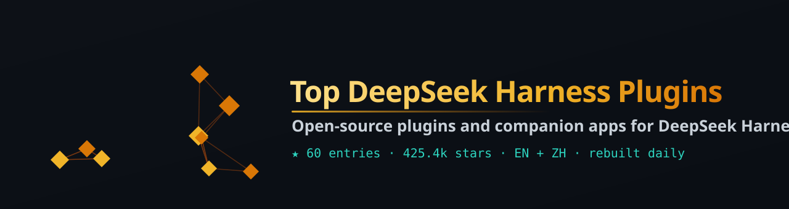

# DeepSeek Harness 插件与生态工具大全

<i>DeepSeek Harness（dsh）的开源插件和配套应用：安全与权限守卫、记忆、桌面端、网页端和终端客户端、模型路由与插件市场，按 GitHub Stars 排名</i>

  

  

[English](README.md) · **简体中文**

---

> **为什么是现在:** 2026-10-25 这一周，[dsh-Go](https://github.com/ccch1mneyyy/dsh-Go) 等新的 DeepSeek Harness 配套项目成为本周 Stars 最多的新 DeepSeek Harness 仓库；[SSD Nodes 发布了值得安装的插件指南](https://www.ssdnodes.com/learn/deepseek-harness-plugins-worth-installing)（2026-10-30），提醒插件拥有和 agent 一样的完整权限。本榜按 Stars 排出 [DeepSeek Harness](https://github.com/deepseek-ai/deepseek-harness) 周边的开源插件和应用。

---

## 目录

- [🏆 精选 Top](#top-picks)
- [Routing, Markets & Bots](#sec-1) · 15
- [Desktop, Web & Terminal Clients](#sec-2) · 15
- [Memory & Context](#sec-3) · 15
- [Security, Permissions & Budget](#sec-4) · 15
- [📖 关于本列表](#about)

## 🏆 精选 Top

| # | 项目 | ⭐ Stars | 语言 | 更新 | 简介 |
|:-:|:--|--:|:-:|:-:|:--|
| 1 | [**deepseek-ai/deepseek-harness**](https://github.com/deepseek-ai/deepseek-harness) | 278.6k | TypeScript | 2026-11-04 | DeepSeek Harness: Everything is a Plugin. |
| 2 | [**anywhere-labs/dsh-desktop**](https://github.com/anywhere-labs/dsh-desktop) | 35.7k | TypeScript | 2026-11-06 | 为 DeepSeek Harness (DSH) 插件生态打造的现代化桌面端解决方案。万物皆「插件」，桌面本身也是「插件」。 |
| 3 | [**ccch1mneyyy/dsh-Go**](https://github.com/ccch1mneyyy/dsh-Go) | 19.2k | Dart | 2026-11-11 | dsh-go — DeepSeek Harness 装进口袋：手机本机运行，也能遥控你的电脑。 |
| 4 | [**dataelement/dsh-desktop**](https://github.com/dataelement/dsh-desktop) | 18.1k | JavaScript | 2026-11-11 | DSHDesktop：DeepSeek Harness Desktop / DeepSeek Harness 桌面版 |
| 5 | [**dsh-market/dsh-market**](https://github.com/dsh-market/dsh-market) | 11.9k | TypeScript | 2026-11-10 | The plugin market inside DeepSeek Harness — browse, search, one-click install · DSH 可视化插件市场 |

## Routing, Markets & Bots

| # | 项目 | ⭐ Stars | 语言 | 更新 | 简介 |
|:-:|:--|--:|:-:|:-:|:--|
| 1 | [**deepseek-ai/deepseek-harness**](https://github.com/deepseek-ai/deepseek-harness) | 278.6k | TypeScript | 2026-11-04 | DeepSeek Harness: Everything is a Plugin. |
| 2 | [**ccch1mneyyy/dsh-Go**](https://github.com/ccch1mneyyy/dsh-Go) | 19.2k | Dart | 2026-11-11 | dsh-go — DeepSeek Harness 装进口袋：手机本机运行，也能遥控你的电脑。 |
| 3 | [**dsh-market/dsh-market**](https://github.com/dsh-market/dsh-market) | 11.9k | TypeScript | 2026-11-10 | The plugin market inside DeepSeek Harness — browse, search, one-click install · DSH 可视化插件市场 |
| 4 | [**MeteorNOX/DeepSeek-Balance-Whale-Widget**](https://github.com/MeteorNOX/DeepSeek-Balance-Whale-Widget) | 7.1k | JavaScript | 2026-10-11 | DeepSeek Harness（DSH）一只住在 DSH 界面右下角的小鲸鱼娘，帮你盯着DeepSeek账户余额。QQ弹弹，支持拖拽吸附、左吸附翻转、数字滚动动画，随界面自动启用，建议直接喊来你的dsh安装 |
| 5 | [**yjh051108/dsh-routing-suite**](https://github.com/yjh051108/dsh-routing-suite) | 7.0k | JavaScript | 2026-09-18 | dsh-routing-suite — injector + router-standard kit: install the runtime injector first, then the task-aware r… |
| 6 | [**Fei2411/DS-Bot**](https://github.com/Fei2411/DS-Bot) | 6.9k | JavaScript | 2026-11-11 | A team of long-lived bots for DeepSeek Harness, with main bots, bot-to-bot messages and group chats. |
| 7 | [**Alice-Marx/dsh-model-router**](https://github.com/Alice-Marx/dsh-model-router) | 956 | JavaScript | 2026-11-11 | Model Router and Bot plugin for DeepSeek Harness |
| 8 | [**kingOfSoySauce/dsh-skin-market**](https://github.com/kingOfSoySauce/dsh-skin-market) | 325 | TypeScript | 2026-11-11 | DSH皮肤市场Skin Market 已收录五百+皮肤、桌宠、开屏动画等；有便捷的社区收录入口，并且已有多位开发者提交皮肤；有在线页面方便在线浏；有方便安装管理本地皮肤的插件 |
| 9 | [**2BingLing/dsh-market**](https://github.com/2BingLing/dsh-market) | 205 | TypeScript | 2026-11-11 | DeepSeek Harness 插件市场 · 持续收录 6000+ DSH 插件：中文搜索 + 实用五维评分 + 一键安装。Web 版与 DSH 侧边栏插件双形态。Plugin marketplace for Dee… |
| 10 | [**bradeGithub/DSH-Plugins-Marketplace**](https://github.com/bradeGithub/DSH-Plugins-Marketplace) | 203 | JavaScript | 2026-11-11 | DSH插件市场 / DSH Plugin Marketplace: 在 DeepSeek Harness Web GUI 中一键浏览、安装与更新 GitHub topic:dsh-plugin 的全部插件 \| bro… |

展开其余 5 项

| # | 项目 | ⭐ Stars | 语言 | 更新 | 简介 |
|:-:|:--|--:|:-:|:-:|:--|
| 11 | [**yjh051108/dsh-super-injector**](https://github.com/yjh051108/dsh-super-injector) | 167 | TypeScript | 2026-10-16 | 推荐组件（非必须）：DeepSeek Harness 运行时注入器；已随 dsh-routing-suite 单仓库化保留，本仓库继续维护/发布。 |
| 12 | [**yi-yezhiqiu/dsh-prompt-market**](https://github.com/yi-yezhiqiu/dsh-prompt-market) | 111 | JavaScript | 2026-10-11 | DeepSeek Harness 提示词市场插件：对话框内一键浏览、搜索、收藏提示词，选中即写入输入框。零后端、免构建、数据只存本机。 \| A prompt marketplace for DSH: browse,… |
| 13 | [**Sanqi-normal/dsh-webui-market-plugin**](https://github.com/Sanqi-normal/dsh-webui-market-plugin) | 103 | JavaScript | 2026-08-22 | dsh Web GUI 社区插件市场：浏览 awesome-dsh-plugin.com 插件目录，一键安装/卸载到 profile。Community plugin market for the DeepSeek H… |
| 14 | [**ccch1mneyyy/dsh-go-market**](https://github.com/ccch1mneyyy/dsh-go-market) | 54 | JavaScript | 2026-11-10 | DSH Go plugin catalog with pinned versions and automated risk checks |
| 15 | [**aqiu817/dsh-llm-agentrouter**](https://github.com/aqiu817/dsh-llm-agentrouter) | 38 | JavaScript | 2026-10-22 | DeepSeek Harness bundle: the AgentRouter relay as one pi-ai route with a domestic/international endpoint swit… |

## Desktop, Web & Terminal Clients

| # | 项目 | ⭐ Stars | 语言 | 更新 | 简介 |
|:-:|:--|--:|:-:|:-:|:--|
| 1 | [**anywhere-labs/dsh-desktop**](https://github.com/anywhere-labs/dsh-desktop) | 35.7k | TypeScript | 2026-11-06 | 为 DeepSeek Harness (DSH) 插件生态打造的现代化桌面端解决方案。万物皆「插件」，桌面本身也是「插件」。 |
| 2 | [**dataelement/dsh-desktop**](https://github.com/dataelement/dsh-desktop) | 18.1k | JavaScript | 2026-11-11 | DSHDesktop：DeepSeek Harness Desktop / DeepSeek Harness 桌面版 |
| 3 | [**zhu1090093659/dsh-web**](https://github.com/zhu1090093659/dsh-web) | 10.3k | TypeScript | 2026-11-11 | DeepSeek Harness (DSH) Web 插件聚合生态 · 万物皆插件，通过创意工坊分发｜｜DeepSeek Harness (DSH) Web Plugin Aggregation Ecosystem ·… |
| 4 | [**ccch1mneyyy/dsh-TUI**](https://github.com/ccch1mneyyy/dsh-TUI) | 7.5k | TypeScript | 2026-11-11 | DSH's officially top-recommended TUI plugin — high performance, low overhead, cute pixel whale, smooth mouse… |
| 5 | [**dsh-tauri/deepseek-harness-desktop**](https://github.com/dsh-tauri/deepseek-harness-desktop) | 3.6k | TypeScript | 2026-11-10 | DSH Tauri 桌面版 \| Better DSH desktop, zero environment setup, preset plugins, Windows / macOS / Linux. |
| 6 | [**Ebony-Vinyl/EAC-Desktop**](https://github.com/Ebony-Vinyl/EAC-Desktop) | 3.3k | JavaScript | 2026-11-10 | Embracing All Creation (Desktop) — Dedicated to the Harmonious Coexistence of Hundreds of DSH Plugins / 揽尽万象（… |
| 7 | [**sixtysevenlf/dsh-blender-plugin**](https://github.com/sixtysevenlf/dsh-blender-plugin) | 2.0k | Python | 2026-11-09 | DSH × Blender 直连插件 v3.0.6：15 个模型工具让 AI 驱动 GUI Blender（视口 / 自定义视角 / 无头 worker / 作业层 / 事务回滚 / 配方库），34 family /… |
| 8 | [**ningbainb/deepseek-harness-desktop**](https://github.com/ningbainb/deepseek-harness-desktop) | 927 | JavaScript | 2026-11-04 | Open-source Windows desktop client and GUI for DeepSeek Harness — zero-setup installer with Codex, plugins, s… |
| 9 | [**myYangyunfan/dsh_desktop**](https://github.com/myYangyunfan/dsh_desktop) | 748 | JavaScript | 2026-11-11 | DeepSeek Harness (dsh) Windows desktop client - bundled Node.js + dsh CLI, one-click launch |
| 10 | [**helloHub1212/dsh-windows-mcp**](https://github.com/helloHub1212/dsh-windows-mcp) | 625 | JavaScript | 2026-11-11 | Windows desktop automation for DeepSeek Harness: the in-box MCP client bridge mounted against CursorTouch/Win… |

展开其余 5 项

| # | 项目 | ⭐ Stars | 语言 | 更新 | 简介 |
|:-:|:--|--:|:-:|:-:|:--|
| 11 | [**QCYTSN/dsh-dafeiyu**](https://github.com/QCYTSN/dsh-dafeiyu) | 611 | JavaScript | 2026-10-29 | Desktop-native BigFish companion for DeepSeek Harness — real Agent status, always on top on Windows. |
| 12 | [**Nwflower/dsh-claude-style**](https://github.com/Nwflower/dsh-claude-style) | 561 | TypeScript | 2026-11-11 | Claude Code Desktop theme for DeepSeek Harness｜ 为 DeepSeek Harness 复刻 Claude Code Desktop 风格与交互体验的主题插件 |
| 13 | [**vibeinging/dsh-desktop**](https://github.com/vibeinging/dsh-desktop) | 492 | JavaScript | 2026-11-10 | DeepSeek Harness Desktop App: a local AI desktop workspace for DSH Sessions, projects, files, web research, p… |
| 14 | [**techflag/workdsh**](https://github.com/techflag/workdsh) | 326 | TypeScript | 2026-10-31 | A WorkBuddy-style desktop workspace powered by the DSH plugin ecosystem. WorkDSH manages projects, assets, ex… |
| 15 | [**hust-open-atom-club/oh-dsh**](https://github.com/hust-open-atom-club/oh-dsh) | 324 | TypeScript | 2026-09-12 | 一套 DSH runtime，Desktop、Web 与 TUI 三种开发体验。 |

## Memory & Context

| # | 项目 | ⭐ Stars | 语言 | 更新 | 简介 |
|:-:|:--|--:|:-:|:-:|:--|
| 1 | [**omdsh-dev/dsh-mnemon**](https://github.com/omdsh-dev/dsh-mnemon) | 965 | TypeScript | 2026-11-10 | Composable, view-based context for DeepSeek Harness. Pluggable sources and strategies, with layered memory an… |
| 2 | [**csyangwen/dsh-memory-evolve**](https://github.com/csyangwen/dsh-memory-evolve) | 777 | JavaScript | 2026-10-29 | 为 DeepSeek Harness 带来「跨会话长期记忆 + 后台自我进化」能力的纯插件实现：五轨记忆 · git 分支感知 · 回合内自我审查 · 技能自我进化与技能管理器 · 四轨待办 · COI 调度 · 会话… |
| 3 | [**adoresever/graph-memory**](https://github.com/adoresever/graph-memory) | 674 | TypeScript | 2026-10-01 | Deepseek Harness、Openclaw知识图谱记忆插件。2026年4月受邀发布在清华大学讨论会。Knowledge Graph + Memory；Knowledge Graph Context Engine… |
| 4 | [**Yuuyuko-uu/dsh-fish-memory**](https://github.com/Yuuyuko-uu/dsh-fish-memory) | 510 | JavaScript | 2026-11-09 | 🐋 DSH 鱼的记忆：给会话一份会淡忘的长期记忆，每条都带时间。名字里的「鱼」来自 DeepSeek 的鲸鱼。 |
| 5 | [**Phant0Meow/dsh-meow-memory**](https://github.com/Phant0Meow/dsh-meow-memory) | 384 | TypeScript | 2026-11-06 | Cross-session memory plugin for DeepSeek Harness: seven-layer SQLite store (soul/user/project/fact/lesson/top… |
| 6 | [**huiliyi37/dsh-tianshu-tui**](https://github.com/huiliyi37/dsh-tianshu-tui) | 302 | TypeScript | 2026-11-10 | 官方 DeepSeek Harness 的交互式终端 UI 插件：自研 ANSI 极简交互渲染、流式 Markdown/工具卡、16+ 主题、slash 命令与选择器、输入历史与本地偏好持久化、LSP 诊断、memor… |
| 7 | [**See-Sol-Lab/DeepSeekGUI**](https://github.com/See-Sol-Lab/DeepSeekGUI) | 275 | TypeScript | 2026-11-05 | 基于 DeepSeek Harness（DSH）的稳定桌面端，集成Git、内置浏览器与记忆功能 \| DeepSeek Harness desktop GUI with local workspaces, Git, b… |
| 8 | [**Amakurai/dsh-liketavern**](https://github.com/Amakurai/dsh-liketavern) | 233 | TypeScript | 2026-11-11 | A DeepSeek Harness (dsh) plugin — turns dsh web into a SillyTavern-style roleplay frontend: character cards,… |
| 9 | [**a86582751/dsh-nexttavern**](https://github.com/a86582751/dsh-nexttavern) | 230 | JavaScript | 2026-11-06 | DeepSeek Harness 长篇角色扮演agent（DSH酒馆插件）：SillyTavern 角色卡导入、行动选项卡、分支对话管理、长篇记忆、关键词与语义混合检索、交互式角色卡创作、世界书、多角色 Agent 集… |
| 10 | [**rlaope/deepseek-bot**](https://github.com/rlaope/deepseek-bot) | 229 | TypeScript | 2026-11-08 | The agentic memory & message gateway for deepseek-harness |

展开其余 5 项

| # | 项目 | ⭐ Stars | 语言 | 更新 | 简介 |
|:-:|:--|--:|:-:|:-:|:--|
| 11 | [**slow-stack/mneme**](https://github.com/slow-stack/mneme) | 220 | JavaScript | 2026-11-11 | 🧠 The memory that dreams — cross-session memory for DeepSeek Harness. Local SQLite + Markdown mirrors, autoDr… |
| 12 | [**Aik358/dsh-auto-memory**](https://github.com/Aik358/dsh-auto-memory) | 195 | JavaScript | 2026-11-07 | Proactive associative memory for DSH: system-prompt recall before the model speaks, three-layer auto-consolid… |
| 13 | [**peterpoal134/memory-brain**](https://github.com/peterpoal134/memory-brain) | 170 | Python | 2026-11-08 | 忆核大脑 / Memory Brain：独立记忆服务 + DSH 插件，原话证据、后台整理、3D 面板、生活与情绪规则。 |
| 14 | [**PerryLink/dsh-memento**](https://github.com/PerryLink/dsh-memento) | 144 | JavaScript | 2026-11-09 | Bounded, layered, approval-gated, auditable cross-session memory for DeepSeek Harness: a ctx.memory capabilit… |
| 15 | [**ZSeven-W/dsh-noema**](https://github.com/ZSeven-W/dsh-noema) | 140 | TypeScript | 2026-10-06 | Noema long-term memory plugin for DSH: durable, inspectable agent memory with recall tools and a settings pag… |

## Security, Permissions & Budget

| # | 项目 | ⭐ Stars | 语言 | 更新 | 简介 |
|:-:|:--|--:|:-:|:-:|:--|
| 1 | [**BotHarness/DeepSeekBot**](https://github.com/BotHarness/DeepSeekBot) | 799 | TypeScript | 2026-11-11 | Open-source GrokBot alternative built on DeepSeek Harness. Build your personal bot team: multiple personal ag… |
| 2 | [**dhicoc/dsh-reverse-skill**](https://github.com/dhicoc/dsh-reverse-skill) | 346 | PowerShell | 2026-10-08 | Complete reverse-skill (88 SKILL.md) as a DeepSeek Harness (dsh) Cordis plugin — reverse engineering, authori… |
| 3 | [**PerryLink/dsh-permission-rules**](https://github.com/PerryLink/dsh-permission-rules) | 136 | TypeScript | 2026-11-09 | Claude Code-style declarative permission rules for DeepSeek Harness: ordered allow/deny/ask rules with tool-n… |
| 4 | [**SteelUnion/dsh-confirm-gate**](https://github.com/SteelUnion/dsh-confirm-gate) | 101 | JavaScript | 2026-11-01 | DeepSeek Harness gate - per-turn persistent-operation counter: remind, instruct the model to stop, then ask f… |
| 5 | [**Anionex/dsh-computer-use**](https://github.com/Anionex/dsh-computer-use) | 98 | TypeScript | 2026-11-06 | 为 DeepSeek Harness 提供电脑控制插件：新鲜 Accessibility 观测、过期状态拒绝、作用域权限与安全输入（目前支持macos）｜Accessibility-first macOS Comput… |
| 6 | [**slywalker2006/dsh-passwords**](https://github.com/slywalker2006/dsh-passwords) | 90 | TypeScript | 2026-10-09 | Server-grade gateway that turns DeepSeek Harness into a multi-tenant platform: remote access + auto HTTPS, su… |
| 7 | [**PensiveFei/dsh-secure-audit**](https://github.com/PensiveFei/dsh-secure-audit) | 86 | JavaScript | 2026-11-02 | Read-only security & compliance plugin for DeepSeek Harness: prompt-injection detection, Chinese-PII redactio… |
| 8 | [**JUANWANG-BUAA/dsh-full-remote**](https://github.com/JUANWANG-BUAA/dsh-full-remote) | 51 | TypeScript | 2026-11-07 | Auditable, token-gated DeepSeek Harness remote gateway: mobile QR access, per-device sessions, Host/Origin re… |
| 9 | [**IceApriler/dsh-remote-mobile**](https://github.com/IceApriler/dsh-remote-mobile) | 49 | JavaScript | 2026-11-03 | DeepSeek Harness 远程与移动端安全网关插件：零修改 DSH 底层代码安全开放局域网与 Tailscale 连接 \| DeepSeek Harness (DSH) Remote & Mobile Sec… |
| 10 | [**xgone/dsh-remote**](https://github.com/xgone/dsh-remote) | 45 | JavaScript | 2026-11-05 | 让你通过浏览器安全地远程使用 DeepSeek Harness：登录、MFA 两步验证、角色权限和远程文件预览。 \| Use DeepSeek Harness securely in a remote browser… |

展开其余 5 项

| # | 项目 | ⭐ Stars | 语言 | 更新 | 简介 |
|:-:|:--|--:|:-:|:-:|:--|
| 11 | [**PerryLink/dsh-defend**](https://github.com/PerryLink/dsh-defend) | 27 | TypeScript | 2026-11-09 | Prompt-injection, jailbreak and secret-leak defense for DeepSeek Harness: Aho-Corasick detection with allow/a… |
| 12 | [**hikariming/dsh-ee**](https://github.com/hikariming/dsh-ee) | 23 | Go | 2026-11-11 | Self-hosted enterprise platform for DeepSeek Harness (DSH): connect company systems and knowledge, build AI m… |
| 13 | [**PerryLink/dsh-skill-pack-security**](https://github.com/PerryLink/dsh-skill-pack-security) | 22 | TypeScript | 2026-11-06 | MOVED to dsh-security-pack — https://github.com/PerryLink/dsh-security-pack. This repository is a pointer/bac… |
| 14 | [**xbzbing/dsh-auth-gateway**](https://github.com/xbzbing/dsh-auth-gateway) | 22 | JavaScript | 2026-11-01 | 为 DeepSeek Harness 增加远程访问能力，并通过密码和 OTP 进行安全加固。 Adds secure remote access to DeepSeek Harness with password au… |
| 15 | [**shaokeyibb/dsh-plugin-product-subagents**](https://github.com/shaokeyibb/dsh-plugin-product-subagents) | 22 | JavaScript | 2026-10-29 | Role-based Codex / Claude Code / ACP subagent providers for the DeepSeek Harness — continuable children, dura… |

## 📖 关于本列表

本列表从 GitHub 自动采集，经过去重、链接检查，按 Stars 排名（Stars 相同时按最近更新排序），并定时自动刷新，数据始终保持最新。

---

自动生成 · 定时刷新 · 按 GitHub Stars 排名 · 2026-11-11

